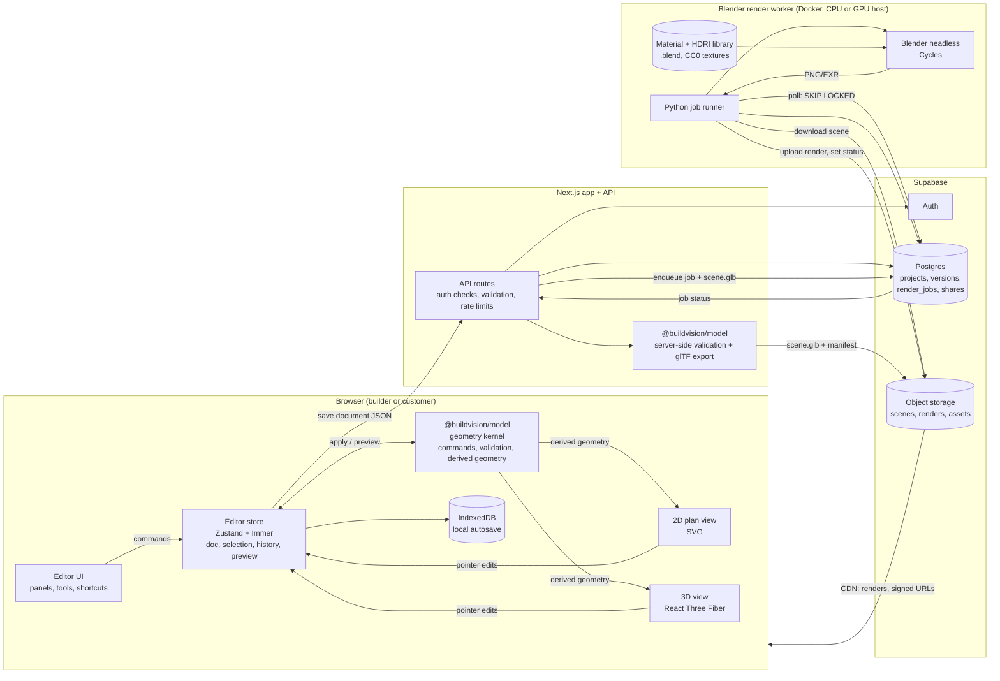
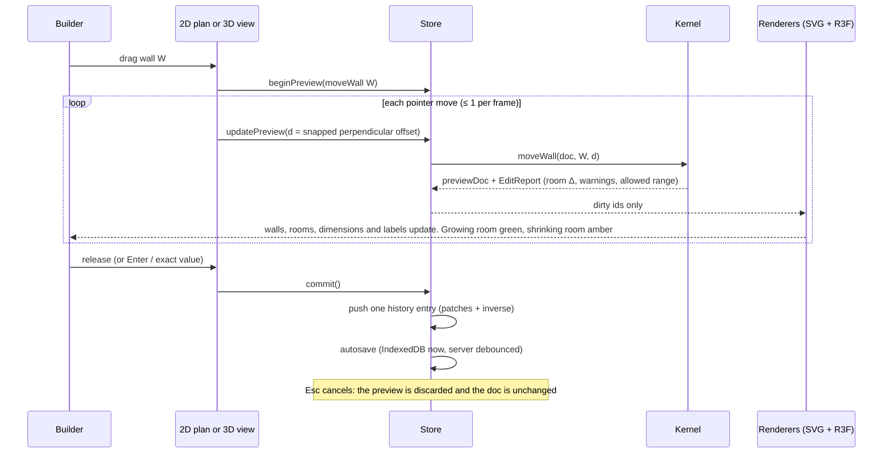

# BuildVision — Stage 0 Technical Plan

Status: **proposal, awaiting approval.** No product code has been written or prototyped yet; nothing in this document has been proven to work. Anything described as "will" is a design intent.

Date: 2026-11-24

---

## 1. Technical assessment of the current repository

**This repository holds no BuildVision code, and none of it can be reused.**

| Item | Finding |
|---|---|
| Repo | `chandlerlaporte/blind-stage-relay` |
| Contents | A 253-line, dependency-free Node.js WebSocket relay for a co-op game called *Blind Stage* (`index.js`, `relay.js`, `stats.js`), plus a Render blueprint (`render.yaml`) |
| Deployment | `render.yaml` has `autoDeploy: true`, so any merge to `main` redeploys the live game relay |
| Reusable for BuildVision | Nothing. It has no front end, no 3D, no database and no auth |
| Tests | None |

**Development environment (this cloud container):**

| Tool | Available |
|---|---|
| Node.js | 22.x ✅ |
| pnpm / yarn / bun | 10.x / 1.22 / 1.4 ✅ |
| Python | 3.13 ✅ |
| Docker | 29.x ✅ (enough to run a containerised Blender worker) |
| PostgreSQL client | 16 ✅ |
| Blender | ❌ not installed (can run in Docker for the render proof) |
| GPU | ❌ none. CPU only: 4 vCPU, 15 GB RAM |

**What this means:**
- BuildVision should live in its own repository. If it shares this repo, merging to `main` risks breaking the live relay's Render deploy, and the two products' histories get mixed together. **You need to create the repo** (for example `chandlerlaporte/buildvision`) because I can't create repositories from this session. Until then this plan lives on branch `claude/buildvision-architecture-gwwl3n` in `docs/buildvision/`, which doesn't touch the relay's files.
- Without a GPU, the Blender proof uses **Cycles on the CPU** at low samples with denoising. Eevee needs a GPU/OpenGL context and is unreliable on a headless server. This matches your request not to rely on expensive local rendering.
- The geometry kernel and its tests run in plain Node in a few seconds, so they run fine on modest hardware.

---

## 2. Proposed system architecture

### Guiding decisions

1. **The building document is the single source of truth.** It's a normalized JSON document of levels, wall nodes, walls, openings, rooms and so on. Everything else is *derived* from it: 2D drawings, 3D meshes, room areas, dimensions, the glTF sent to Blender, and later IFC.
2. **A pure TypeScript geometry kernel (`@buildvision/model`)** owns all editing rules and geometry. It has no React, no Three.js and no DOM. It runs in the browser, in Node (server validation, scene export), in tests, and later in the presentation viewer. This is what makes the "intelligent wall" behaviour testable and keeps it from being a visual trick.
3. **Edits are commands, not mutations.** Each user action (move wall, add door, set thickness) is a kernel command that returns a new document plus an *edit report*: changed entities, room area deltas, warnings and errors. Undo and redo use the command patches.
4. **Rule-based edit semantics, not a general constraint solver, for the MVP.** General geometric constraint solving is a deep rabbit hole. Explicit, predictable rules for each operation are easier to test and easier for builders to understand. (We can evaluate a solver such as FreeCAD's `planegcs` compiled to WASM later, for dimension locks.)
5. **Blender is only a rendering worker.** It receives an exported scene plus a material manifest and returns images. It never edits the model.
6. **The simplest backend that works:** one Next.js app plus Supabase (Postgres, Auth, Storage), and one Python Blender worker process that polls a Postgres job table. No Redis, no Kubernetes and no microservices until load demands them.

### Technology choices

| Layer | Choice | Why |
|---|---|---|
| Monorepo | pnpm workspaces | Shares the kernel between the editor, the server and the export scripts |
| Geometry kernel | TypeScript, Vitest, fast-check (property tests) | Pure, deterministic and fast to test |
| 2D polygon booleans | Clipper2 port or `polygon-clipping` (to evaluate in Stage 0) | Robust integer-millimetre booleans for room interiors |
| Editor state | Zustand + Immer (patches give undo/redo) | Small and explicit. Immer patches double as the history format |
| 2D plan | SVG rendered by React, custom pan/zoom | Crisp lines and text, easy hit-testing, prints and exports to PDF later. Fine for a few thousand elements |
| 3D view | Three.js + React Three Fiber + Drei | Mature and well documented. Per-entity meshes are updated in place |
| PoC shell | Vite + React | Fast and light on a modest machine. The editor is a package that drops into Next.js later |
| SaaS app (Stage 4) | Next.js (App Router), Tailwind | Marketing site, dashboard and API routes in one deployable |
| Auth / DB / storage | Supabase (Postgres + Row Level Security + Storage) | Auth, ownership rules and file storage without running our own servers |
| Render queue | Postgres `render_jobs` table (`FOR UPDATE SKIP LOCKED`) | No extra infrastructure |
| Render worker | Blender LTS (pinned version) in Docker, Python job runner | Isolated and reproducible, and it can move to a GPU host |
| Scene interchange | glTF 2.0 (`.glb`) + JSON material manifest | Blender's glTF importer is first-party. Material slots are swapped for high-quality Blender materials by ID |
| IFC (Stage 6) | IfcOpenShell (LGPL-3.0), server-side | For import/export, not as the live model |
| Billing (Stage 4+) | Stripe test mode | As you requested, after the core product is tested |
| Monitoring | Sentry (free tier) + structured logs | |

### Licensing notes

- **Blender** is GPL. We run it as a separate server-side process and never distribute it, so the GPL doesn't reach our app code. Keep the worker scripts in their own package. Confirm with a lawyer before selling.
- **IfcOpenShell** is LGPL-3.0, which is fine for server-side use.
- **Assets:** use Poly Haven and ambientCG (CC0) for textures and HDRIs to start. Furniture and fixtures must be original or properly licensed. Don't scrape competitor libraries.

---

## 3. Architecture diagrams

### 3.1 System overview



### 3.2 One edit flowing through both views



### 3.3 Render job

```mermaid
sequenceDiagram
  participant B as Builder
  participant A as API
  participant D as Postgres
  participant O as Storage
  participant W as Blender worker
  B->>A: request render (version, camera, preset)
  A->>A: check auth, plan quota, rate limit
  A->>A: kernel exports scene.glb + materials.json + camera.json
  A->>O: upload scene bundle
  A->>D: insert render_job (queued), reserve credit
  W->>D: claim next job (FOR UPDATE SKIP LOCKED)
  W->>O: download bundle
  W->>W: blender -b -P render_job.py (import glb, swap materials, sky/sun, camera, Cycles)
  W->>D: progress updates
  W->>O: upload image + thumbnail
  W->>D: status = done (or failed + reason; credit refunded)
  B->>A: poll / realtime subscription
  A-->>B: signed image URL
```

---

## 4. Native parametric building data structure

Conventions:
- **Units:** all lengths are stored as **millimetres**. Committed plan coordinates are rounded to whole millimetres, which keeps the polygon booleans robust. The display converts to **feet-inches** (the default for North American builders) or metric.
- **Plan axes:** x = east, y = north, z = up. The mapping to Three.js (y-up) lives in one module.
- **Normalized maps keyed by ID.** This makes patches small and keeps undo/redo exact. It also makes database storage straightforward and is ready for collaboration later.
- **Stored vs derived:** stored entities are what the user authored. Derived geometry is recomputed and never edited directly.

```ts
type Id = string;           // nanoid
type Mm = number;           // millimetres
interface Vec2 { x: Mm; y: Mm }

interface ProjectDocument {
  schemaVersion: 1;                        // versioned with migrations
  id: Id;
  name: string;
  settings: {
    displayUnits: 'imperial' | 'metric';
    gridMm: Mm;                            // e.g. 25.4 * 6 = 6" grid
    dimensionReference: 'finishFace' | 'centerline';
  };
  site: { northAngleDeg: number; latitude?: number; longitude?: number };
  buildings: Record<Id, Building>;         // MVP: exactly one
  levels:    Record<Id, Level>;
  nodes:     Record<Id, WallNode>;         // wall junctions. Sharing a node IS the join
  walls:     Record<Id, Wall>;
  openings:  Record<Id, Opening>;
  rooms:     Record<Id, Room>;             // user data. Geometry is derived
  slabs:     Record<Id, Slab>;
  roofs:     Record<Id, Roof>;
  stairs:    Record<Id, Stair>;            // Stage 2+ (schema reserved)
  columns:   Record<Id, Column>;           // Stage 2+
  fixtures:  Record<Id, FixtureInstance>;  // furniture, cabinets, fixtures
  materials: Record<Id, MaterialAssignment>; // project palette -> library IDs
  cameras:   Record<Id, SavedCamera>;
}

interface Building { id: Id; name: string; levelIds: Id[] }

interface Level {
  id: Id; buildingId: Id; name: string;
  elevation: Mm;               // top of subfloor relative to project zero
  floorToFloor: Mm;
  defaultWallHeight: Mm;       // e.g. 2438 (8'-0") or 2743 (9'-0")
  defaultCeilingHeight: Mm;
  slabThickness: Mm;
}

interface WallNode { id: Id; levelId: Id; p: Vec2 }

interface Wall {
  id: Id; levelId: Id;
  start: Id; end: Id;          // WallNode IDs. The centerline runs start -> end
  thickness: Mm;               // total assembly thickness
  locationLine: 'center';      // MVP. 'interiorFace' | 'exteriorFace' later
  kind: 'exterior' | 'interior';
  baseOffset: Mm;              // from level elevation
  top: { mode: 'levelHeight' } | { mode: 'fixed'; height: Mm } | { mode: 'toRoof'; roofId: Id };
  finish: { left: Id; right: Id };   // material IDs. Left/right relative to start -> end
}

interface Opening {
  id: Id; hostWallId: Id;
  kind: 'door' | 'window' | 'garageDoor' | 'cased';
  catalogId: Id;               // product/style from the opening catalog
  offset: Mm;                  // centreline distance from host start node to opening centre
  width: Mm; height: Mm;
  sillHeight: Mm;              // 0 for doors
  anchor: 'auto' | 'start' | 'end' | 'center'; // how it follows host length changes (see §5)
  swing?: { hinge: 'start' | 'end'; side: 'left' | 'right' };
  frameMaterial?: Id;
}

interface Room {
  id: Id; levelId: Id;
  name: string;
  type: 'living' | 'kitchen' | 'bedroom' | 'bath' | 'hall' | 'garage' | 'other';
  // Used to re-identify the room after topology edits (see §5.6)
  identity: { boundaryWallIds: Id[]; seed: Vec2 };
  finishes: { floor: Id; walls?: Id; ceiling: Id };
  ceilingHeight?: Mm;          // overrides level default
}

interface Slab  { id: Id; levelId: Id; source: 'autoFromExteriorWalls' | { polygon: Vec2[] }; thickness: Mm; material: Id }
interface Roof  { id: Id; levelId: Id; shape: 'gable' | 'hip' | 'shed'; footprintWallIds: Id[];
                  pitch: { rise: number; run: 12 }; overhang: Mm; ridgeDirection: 'x' | 'y'; material: Id }
interface FixtureInstance { id: Id; levelId: Id; catalogId: Id; p: Vec2; rotationDeg: number;
                            hostWallId?: Id; roomId?: Id; finishes?: Record<string, Id> }
interface MaterialAssignment { id: Id; libraryId: string; tint?: string; scaleMm?: Mm; rotationDeg?: number }
interface SavedCamera { id: Id; name: string; kind: 'exterior' | 'interior';
                        position: [Mm, Mm, Mm]; target: [Mm, Mm, Mm]; fovDeg: number }
```

**Derived (cached, recomputed by the kernel, never persisted as the source of truth):**

```ts
interface DerivedLevel {
  wallSolids: Record<Id, { outline: Vec2[]; faces: WallFaceGeometry }>; // mitred/butted footprint
  roomGeometry: Record<Id, {
    centerlineFace: Id[];      // ordered half-edges of the planar-graph face
    interior: Vec2[];          // finished interior polygon (minus wall footprints)
    area: number; perimeter: Mm;
    clearDims?: { width: Mm; depth: Mm };  // for rectangular rooms
  }>;
  dimensions: DimensionString[];  // auto exterior strings + per-room clear dims
  issues: Issue[];                // validation warnings/errors with entity IDs
}
```

**Constraints in the MVP** are implicit and enforced by the kernel's commands:
- Walls are joined when they share a node.
- Openings are hosted on a wall with fit rules.
- There are minimum lengths, clearances and room sizes.
- Topology is preserved during a drag.

Explicit user constraints ("lock this dimension", "keep parallel") are stored later as `constraints: Record<Id, Constraint>`, in Stage 2 or after.

**Database (Stage 4):** `projects(id, owner_id, org_id, name, archived_at)`, `project_versions(id, project_id, doc jsonb, schema_version, created_by, label, created_at)`, `project_autosaves`, `render_jobs(id, project_version_id, camera_id, preset, status, progress, error, credits, timestamps)`, `renders`, `share_links(id, project_version_id, token_hash, expires_at, revoked_at)`. Row Level Security on every table. A house document is roughly 50–300 KB of JSON.

---

## 5. How moving a wall updates connected rooms and openings

### 5.1 The wall graph

Each level is a **planar graph**: nodes are junctions and walls are edges.
- An **L corner** is a node with 2 walls.
- A **T junction** is a node with 3 walls. The "through" wall is *split into two collinear segments* at the node.
- An **X** is a node with 4 walls.

Splitting through-walls at T nodes matters: no opening can ever straddle a junction, and a junction sliding along a wall just changes two segment lengths.

**Rooms are the faces of this graph.** For each directed half-edge, the next edge is found by taking the tightest clockwise turn at its end node. Each resulting cycle is a face. The unbounded outer face is discarded. Dangling walls (stubs, peninsulas) are excluded from face finding and subtracted afterwards. A room's **finished interior polygon** is its face polygon minus the union of all wall footprints, computed with an integer polygon boolean. That handles mixed thicknesses and stubs correctly. Area uses the shoelace formula on that polygon.

**Wall solids (joins):** at each node the incident walls are sorted by angle. For each adjacent pair, the left face line of one is intersected with the right face line of the next, giving the corner points. Collinear pairs simply continue straight, and free ends get square caps. This gives clean L, T and X joins without CSG. Each wall solid is then extruded to its height. Each long face is a 2D shape with rectangular holes for its openings, triangulated with earcut, plus jamb, head, sill and top faces. There is no 3D boolean anywhere, so updates are cheap.

### 5.2 The move operation

`moveWall(doc, wallId, d, opts) → { doc, report }`. Here `d` is a signed perpendicular offset in mm, either from the drag (snapped) or typed exactly.

1. **Moving set M.** M is the selected wall plus its *collinear run*: segments joined end-to-end in a straight line through T or X nodes. Selecting one exterior segment and dragging moves the whole side of the house, as a builder would expect. (Later, Alt-drag will move a single segment and insert jog walls automatically.)
2. **New line.** L′ = L + d·n, where n is the run's unit normal.
3. **Each node v on the run** gets a new position from the walls attached to it that are *not* in M (call them O(v)):

   | O(v) | Rule | Effect |
   |---|---|---|
   | empty (free end) | p′ = p + d·n | The end just translates |
   | all of O(v) on one line through v (L corner, a stem at a T, or a through-wall where the run ends at a T) | p′ = L′ ∩ line(O) | Each attached wall **keeps its direction** and stretches or shrinks. Junctions slide along the walls they sit on |
   | walls on two or more different lines (e.g. a corner where a diagonal also meets) | **Ambiguous.** The move is not applied | The UI asks which wall should stretch, or blocks with a message. Never silently rotate a wall |

4. **Openings** (§5.3).
5. **Validate** (§5.4). If anything is invalid, the report carries errors, the preview shows them, and commit is blocked.
6. **Report:** changed wall IDs, an area delta per room (*"Bedroom 2: 11.2 m² → 12.0 m² (+0.8)"*, *"Bath: 5.1 → 4.3 (−0.8)"*), updated clear dimensions, warnings, errors, and the **allowed range [d_min, d_max]**.

Example, a T-junction stem (`│` is the interior wall being moved east):

```
before                         after d = +600 mm
┌──────┬────────┐              ┌─────────┬─────┐
│      │        │              │         │     │
│  A   │   B    │      →       │    A    │  B  │   A grows, B shrinks, the outer walls
│      │        │              │         │     │   don't move; the north/south exterior
└──────┴────────┘              └─────────┴─────┘   segments change length (T nodes slide)
```

### 5.3 Openings follow predictable rules

- **The opening's host is in M (the wall itself moved):** keep `offset`. The door moves with its wall.
- **The host stretched (one end slid along it):** keep the opening's **world position** by re-projecting its old centre onto the host. A window in a room's exterior wall doesn't wander because an interior wall moved. `anchor: 'start' | 'end' | 'center'` overrides this when the user sets it.
- **Fit check:** the usable span is `[clear_start, length − clear_end]`, where each clearance is half the thickness of the walls joining at that end plus a minimum trim reveal (default 50 mm, configurable). Openings on the same wall must not overlap either.
  - If the opening is outside the span but the wall is long enough, **slide it the minimum distance** to fit and show a warning (*"Window W3 shifted 4″ to stay clear of the bedroom wall"*).
  - If the wall becomes shorter than the opening, it's an **error**. The opening is drawn red in both views, commit is blocked, and the user can cancel, resize or remove it. The command never produces broken geometry.

### 5.4 Validation, and why there are no surprises

The kernel checks a candidate result for all of these:
- Every wall length is at least the minimum (end clearances + 50 mm), and **no wall reverses direction**.
- **Topology is unchanged during a drag:** no wall footprint newly intersects a wall it isn't joined to. A moved wall can't pass through another wall.
- Every room's interior polygon is simple and at least the minimum room size (default 0.5 m², configurable).
- Openings fit (§5.3).

Wall lengths are linear in `d`, so they give the bounds of the allowed range directly. A sweep test against nearby walls gives the collision bound. **The drag clamps to [d_min, d_max]** and shows a limit marker with the reason (*"Stops 2′-0″ short of the hallway wall"*). Typed values outside the range get a clear message instead.

Because topology is preserved, each room keeps its face and therefore its **identity, name and finishes**. Only coordinates change, which is what makes the result predictable.

### 5.5 Editing by room dimension (ambiguity made explicit)

When the builder selects a room and types a new clear width, there are two possible walls to move. The kernel previews both. The UI shows *"Move east wall → Kitchen −1′-0″"* and *"Move west wall → Hall −1′-0″"* and the builder picks one. Exterior walls are never the default when an interior option exists. This answers the "room-dimension editing frustration" that reviews mention for competitors, and it keeps the semantics explicit.

### 5.6 Topology-changing edits (separate commands, never mid-drag)

These commands each re-derive faces, then reconcile room identity by polygon overlap:
- **Add wall:** auto-splits walls and creates nodes at intersections.
- **Delete wall:** asks for confirmation if hosted openings will be removed.
- **Split / join** walls.

Reconciliation works like this:
- When a room splits, the larger part keeps its ID, name and finishes. New parts inherit its finishes and get a default name.
- When rooms merge, the larger room's ID survives.
- The edit report lists what happened, so nothing is silently discarded.

### 5.7 Floors, ceilings and dimensions

- **Per-room floor finish surfaces and ceilings** come from the room's interior polygon, at floor and at ceiling height.
- **The structural slab** comes from the outer footprint of the exterior walls.
- **Auto dimension strings** (exterior overall dimensions, segment dimensions, per-room clear dimensions) are derived on every change, so they're always current.

### 5.8 Performance

- During a drag, the kernel recomputes only the **dirty set**: walls in M and O, nodes on the run, rooms adjacent to them, and openings on those walls.
- The 3D view updates the `BufferGeometry` of those meshes in place. The SVG re-renders only components whose derived data changed, using memoised selectors.
- Target: under 4 ms of kernel time per pointer move for a 2,500 ft² single-storey plan, measured in Stage 0.

### 5.9 Invariants checked by automated tests

- Undo after any command restores a document deep-equal to the original. Redo restores the result exactly.
- For a drag with exterior walls fixed: **Σ room interior areas + area(union of wall footprints) = outer footprint area**, within 1 mm².
- After every committed command, every opening lies inside its host's usable span and no openings overlap.
- Topology (the face cycles) is identical before and after any `moveWall`.
- Property-based (fast-check): random valid moves on generated rectilinear plans never produce self-intersecting rooms or reversed walls.

---

## 6. Realistic MVP scope

The MVP is what a builder can demo to a customer and pay for in a pilot:

**In scope:**
- A single building with **one level**. A second level comes at the end of the MVP (Stage 2), with simple stacking and no stairs geometry beyond a placeholder.
- Rectilinear walls, plus angled walls with the same rules (no curved walls).
- Exterior and interior walls with thickness presets: 2×4 interior and 2×6 exterior with finishes.
- Rooms auto-detected and named, with live areas and clear dimensions.
- Doors, windows and garage doors from a small catalog (about 15 types).
- 2D plan and 3D view synchronized, editing in both, orbit and a simple first-person walk.
- Move, add, delete and split walls; place, move and resize openings. Undo/redo, grid and alignment snapping, numeric entry, keyboard shortcuts.
- Gable, hip and shed roofs on **rectangular footprints** (one or more roof objects).
- About 40 materials: siding, brick, stone, roofing, flooring, paint, cabinets and countertops. Basic cabinets and fixtures, plus about 30 furniture items (CC0 or original).
- Save/load, autosave with recovery, and named versions.
- Blender renders: draft and standard presets, 3–5 saved cameras, daylight plus interior lights.
- Read-only customer share link with 3D view, renders and the material list.
- Accounts, projects and a basic dashboard. Stripe test mode with plan limits.

**Explicitly out of the MVP:**
- Arbitrary-footprint hip roofs (these need a straight-skeleton algorithm), dormers, curved walls, real stair design, framing, construction documents, IFC, team collaboration, customer self-selection, mobile editing and AI features.
- Any claim of code compliance or permit-readiness.

---

## 7. Development risks and estimated complexity

| # | Risk | Likelihood / impact | Mitigation |
|---|---|---|---|
| 1 | **Geometry robustness**: floating-point and degenerate cases (zero-length walls, near-parallel joins, slivers) | High / High | Integer-mm commits, tolerance constants in one place, integer polygon booleans, property-based tests, a fixture library of nasty plans |
| 2 | **Room identity after topology edits** | Medium / Medium | Overlap-based reconciliation, edit reports, tests per split/merge case |
| 3 | **Roofs**: the hardest common residential feature | High / High | MVP: rectangular-footprint gable, hip and shed only. Arbitrary footprints in Stage 6 (straight skeleton; evaluate library licensing) |
| 4 | **Multi-level** (alignment, stairs, slab openings) | Medium / High | Stacked levels first, stairs later |
| 5 | **Render quality vs time vs cost** on CPU | Medium / Medium | Presets, denoising, a material library prepared once, GPU host option, credits per preset |
| 6 | **3D performance on ordinary laptops** | Medium / Medium | Low-poly derived geometry, instanced fixtures, KTX2 textures, adaptive pixel ratio, no real-time shadows by default on weak GPUs |
| 7 | **Asset licensing** | Medium / High | CC0 sources only, plus an asset provenance log |
| 8 | **Scope creep vs mature CAD tools** | High / High | Strict stage gates. Sell "fast customer-facing design changes", not CAD replacement |
| 9 | **Market risk**: builders may not pay or switch | High / High | Validate with pilots before Stage 3/4 infrastructure spend (§11) |
| 10 | **Solo-developer bandwidth** | High / Medium | Small vertical milestones, each one demoable |

**Complexity, from hardest to easiest:** roofs, robust wall/room editing, multi-level, Blender material fidelity, customer presentations, SaaS shell, billing.

---

## 8. Expected development and infrastructure costs

These are rough estimates, not quotes. Cloud prices change, so verify current pricing before committing.

### Development effort

Estimates assume one experienced full-time engineer working with AI assistance:

| Stage | Effort |
|---|---|
| 0: Technical proof | 1.5–2.5 weeks |
| 1: Interactive prototype | 3–5 weeks |
| 2: Functional editor (roofs, multi-level, save/load) | 6–10 weeks |
| 3: Blender visualization | 3–5 weeks |
| 4: SaaS dashboard + billing groundwork | 3–5 weeks |
| 5: Customer presentations | 2–4 weeks |
| **To a sellable pilot (end of Stage 5)** | **≈ 5–8 months** |

If fully outsourced at about CAD $100–150/hour, the same scope would cost roughly **CAD $90k–200k**. 3D asset creation (furniture, cabinets) is a separate line item: either budget for CC0 sources and modelling time, or buy licensed packs that permit SaaS use.

### Infrastructure (monthly)

| Phase | Components | Approx. monthly |
|---|---|---|
| Development | Local + free tiers (Supabase free, Vercel hobby), Blender in Docker locally or a small VPS on demand | $0–25 |
| Pilot (≤ 20 builders) | Vercel Pro (~$20), Supabase Pro (~$25 + usage), one 8-vCPU CPU render box (~$30–80) or on-demand GPU, Sentry free/team, domain + email | **$100–250** |
| Early growth (~100 paying) | Bigger DB, 1–3 render workers (autoscaled GPU), CDN egress | $400–1,200 |

**Per-render cost:**
- **CPU box:** a 1080p Cycles render with denoising takes very roughly 3–15 minutes. The marginal cost is about $0 until the box is saturated (about 4–15 renders/hour per box).
- **On-demand GPU:** roughly 30–120 s per render at about $0.30–1.00/hour, which works out to **about $0.01–0.05 per standard render**.

Storage for renders (1–5 MB each) is negligible at pilot scale. At the proposed prices, rendering credits can be generous without hurting margins. The real cost driver is engineering time, not hosting.

---

## 9. Milestone-by-milestone implementation plan

Every milestone ends with: the app runs, tests pass, docs are updated, there's a commit, and a short demo note of what works and what doesn't.

**Stage 0: Technical proof (this proposal)**
- **0.1** Monorepo scaffold: `packages/model`, `apps/editor` (Vite + React + R3F), Vitest, ESLint, Prettier and CI.
- **0.2** Kernel core: types, document validation (zod), the PoC house fixture, planar-graph face finding, wall-join solids, room interior polygons and areas. Tests.
- **0.3** `moveWall` command with the full rules from §5, allowed range and edit report. Undo/redo through the command history. Tests, including the invariants in §5.9.
- **0.4** 2D SVG plan: walls, rooms, labels, areas, dimensions, select, drag, numeric entry, snapping to a 1″ or 10 mm grid.
- **0.5** 3D view: extruded walls with real opening holes, floors, ceilings toggle, orbit, select and drag on the ground plane. Same store, same commands.
- **0.6** Blender proof: a Node script exports a saved project to `scene.glb` + `materials.json`. A Docker image with pinned Blender runs `render_job.py` and produces a PNG (Cycles, CPU, low samples, denoised). This is a proof only: no queue or UI yet.
- **0.7** Measurements: kernel time per drag frame, FPS on a low-end profile (CPU throttling in Chrome), and the render time of the Blender proof. Written up.

**Stage 1: Interactive building prototype**
- Add, delete and split walls; place, move and resize openings; room identity reconciliation.
- Wall property panel (thickness, height, finishes) and opening catalog v1.
- Material palette v1 (about 15 materials) applied in 3D.
- Alignment guides, angle snapping (0/45/90), and the room-dimension editing flow from §5.5.
- A wider keyboard shortcut set, and an error/warning panel.
- Playwright end-to-end test: drag a wall in 2D, assert the 3D mesh and the room areas changed.
- **Acceptance test:** move an interior wall in either view and both views update. Room dimensions and areas recalculate, hosted openings stay valid (or a clear error appears), and undo/redo is exact.

**Stage 2: Functional home editor**
- More templates (3–5 plans), angled walls, cabinets and fixtures snapped to walls.
- Floor and ceiling finishes, rectangular gable/hip/shed roofs, exterior trim.
- Save/load to JSON plus IndexedDB autosave and recovery. Schema migrations.
- Second level: stacking, wall alignment from the level below, and level visibility.
- Section cut and level isolation in 3D, plus the first-person walkthrough.

**Stage 3: Blender visualization**
- Production material library (.blend) mapped to material IDs, with sky and sun from site orientation, and interior lighting.
- Camera presets plus saved cameras; draft, standard and high quality presets.
- `render_jobs` queue, worker deployment, progress reporting, failures with reasons and refunds, render gallery and downloads.

**Stage 4: SaaS dashboard**
- Next.js app: marketing pages, auth, dashboard, projects, templates, versions, rename/duplicate/archive.
- Supabase Row Level Security, server-side document validation, rate limits and storage quotas.
- Stripe test mode: plans, limits, render credits and a clear cancellation flow.

**Stage 5: Customer presentations**
- Signed, revocable, expiring share links; a read-only viewer bundle with renders, the material list and a guided walkthrough.
- Version comparison (A/B options) and builder branding.

**Stage 6: Professional expansion**
- IFC export and import (IfcOpenShell), arbitrary-footprint roofs, stairs, schedules, teams and integrations.

---

## 10. The exact first proof of concept

**Goal:** prove the core claim. One editable model drives a 2D plan and a 3D view, and moving an interior wall updates connected geometry correctly and predictably.

**The house** (fixture `poc-house.json`, single storey):
- 40′-0″ × 28′-0″ (12,192 × 8,534 mm) rectangle.
- Exterior walls 2×6 with finishes, about 7¼″ (184 mm). Interior walls 2×4, about 4½″ (114 mm). Walls are 8′-1⅛″ high.
- Six rooms: Living/Dining, Kitchen, Hall, Bedroom 1, Bedroom 2, Bath.
- About 9 interior wall segments, including T junctions on exterior walls and on other interior walls, and at least one X or double-T.
- 1 front door, 5 interior doors (two hosted on *the wall we will move*), and 7 windows (two on exterior segments whose length changes when the wall moves).

**Interactions:**
- Click a wall in either view to highlight it in both, and open the property panel (length, thickness, height).
- Drag the **Bedroom 1 / Bedroom 2 partition**. During the drag:
  - Both bedrooms' areas and clear widths update live, coloured as growing or shrinking.
  - The hall wall it tees into stretches correctly.
  - The exterior segments change length.
  - The doors in the moving wall travel with it.
  - The exterior windows stay put.
  - The drag stops at the computed limit, with the reason shown.
- Type an exact offset or clear width (for example `11'6"`) and press Enter.
- Esc cancels; Ctrl/Cmd+Z / Shift+Ctrl/Cmd+Z undo and redo.
- Force a conflict: shrink a bedroom until a window no longer fits. The window turns red with a message and commit is blocked.
- 3D: orbit, toggle ceilings and a dollhouse cut, and drag the same wall in 3D with the same result.

**Proof outputs:**
- Kernel unit tests and property tests for face finding, joins, `moveWall` rules, opening rules, undo/redo and the invariants in §5.9.
- One Playwright test that drags in 2D and asserts the 3D wall mesh moved and the room areas changed.
- A Blender render of the PoC house exterior (and one interior) from the saved JSON.
- A short write-up of measured kernel time per frame, FPS, render time, and **what does not work yet**.

**Dependencies to be installed after approval** (all MIT/BSD/Apache unless noted):
- Front end: `react`, `react-dom`, `vite`, `typescript`, `three`, `@react-three/fiber`, `@react-three/drei`, `zustand`, `immer`
- Validation and geometry: `zod`, `nanoid`, a polygon-boolean library (Clipper2 port or `polygon-clipping`, to compare), `earcut` (ISC)
- Testing: `vitest`, `fast-check`, `@playwright/test` (using the pre-installed Chromium)
- Rendering: Docker image `blender` (GPL, run as a separate process)

---

## 11. Market validation (parallel to Stage 0–1, before the Stage 3/4 spend)

**Interview questions for builders** (30 minutes; ask about the past, not hypotheticals):
1. Walk me through the last time a customer asked for a layout change. Who changed the drawings, how long did it take, and what did it cost?
2. What software do you use today for plans and for showing customers? What do you pay? Who on your team uses it?
3. When did a customer misunderstand a design, and what did it cost you (change orders, delays, lost sale)?
4. How do you present options today (siding, flooring, layouts)? What happens after the meeting?
5. Do you outsource renderings? To whom, how much per image, and how long does it take?
6. What would have to be true for you to switch tools or add one?
7. If a tool let you change a wall during the customer meeting and show the 3D immediately, which meeting would you use it in first?

**Demo script (10 minutes):**
1. Open the template (1 minute).
2. The customer says *"make bedroom 2 bigger"*. Drag the wall and show the areas, doors and windows updating in 2D and 3D (2 minutes).
3. Swap siding and flooring (1 minute).
4. Show a walkthrough (2 minutes).
5. Show the render and share link (2 minutes).
6. Ask about price and pilot (2 minutes).

**Landing page concept:** a headline in the spirit of *"Design it. Customize it. Visualize it. Sell it."*, a 20-second loop of the wall drag, three benefits (change layouts live with customers, synchronized 2D/3D, renders and share links included), pricing hypotheses, and a "Join the paid pilot" call to action.

**Pilot offer:**
- 3 months at a founding price of CAD $49/month (Professional features), with personal onboarding and a price lock for 12 months.
- Each pilot builder commits to three real customer meetings and a feedback call each month.
- A **paid** commitment is the only strong signal. Free sign-ups and compliments are weak signals.

**Willingness-to-pay test:** use Van Westendorp-style price questions in interviews, followed by an actual pilot payment request (Stripe payment link). Count conversions, not "I'd pay for that."

**Feedback log:** one row per contact. Columns:
- date, builder size, current tools, pains (tagged), demo reaction, price response, pilot yes/no/paid
- next step and quote snippets

Review weekly.

---

## Decisions needed before implementation

1. **Repository:** create a new repo (for example `buildvision`) and add it to this session (recommended), or build in a `buildvision/` folder on this branch for now.
2. **Display units default:** imperial (feet-inches), with metric available?
3. **PoC stack:** approve Vite + React + R3F for the proof, with the kernel as a separate package and Next.js arriving in Stage 4.
4. **Blender proof:** OK to run Blender via Docker (CPU, Cycles) here in the cloud container for step 0.6?
